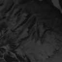
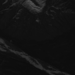
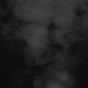
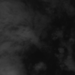
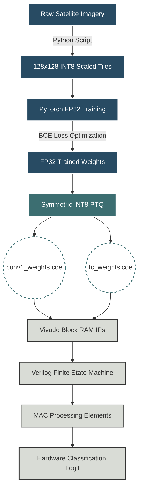

# OpenPulse: Edge-AI FPGA Pipeline for Satellite Telemetry

## Project Overview

The OpenPulse project demonstrates a highly constrained, hardware AI pipeline designed for bare-metal FPGA deployment. The objective is to perform binary image classification (Cloud vs. Clear terrain) directly on satellite telemetry using a custom **F=4 Micro-CNN** mapped to an INT8 systolic array in Verilog.

Because standard floating-point Neural Networks cannot be deployed directly to small FPGAs without memory overflows, this project features a strict Python software pipeline that handles 8-bit integer quantization and specific memory-mapping exports (`.coe` files) for Xilinx Vivado Block RAM (BRAM).

##  Dataset Visual Samples

### 1. Landsat 8 Training Data (128x128 Scaled INT8)

This is the primary training baseline. These images have been preprocessed to strictly single-channel grayscale and scaled to positive 8-bit integers (0 to 127) for direct Verilog compatibility.

**Clear Terrain (Class 0):**
|  |  |  |  |
| :---: | :---: | :---: | :---: |
| `tile_0000.png` | `tile_0001.png` | `tile_0002.png` | `tile_0003.png` |

**Cloudy (Class 1):**
|  |  |  |  |
| :---: | :---: | :---: | :---: |
| `tile_0000.png` | `tile_0001.png` | `tile_0002.png` | `tile_0003.png` |

### 2. SkyPulse Raw Telemetry (Testing Samples)

These are live local satellite captures obtained via a rooftop ground station. They serve as our unseen test data to prove the model can generalize to real-world hardware captures. *(Note: These images represent the raw full-scale captures prior to 128x128 slicing).*

|  |  |  |  |
| :---: | :---: | :---: | :---: |
| `FY-2x_1` | `FY-2x_2` | `FY-2x_3` | `FY-2x_4` |

## Data Sources & Preprocessing

To train and test the model within hardware limits, the image data must be single-channel grayscale, exactly 128x128 pixels, and scaled strictly to positive 8-bit integers (0 to 127).

1. **Training Data (Kaggle 38-Cloud Dataset):**
   * **Source:** Landsat 8 satellite captures.
   * **Usage:** Used as the primary training baseline. Our preprocessing script extracts exactly 1,000 clear and 1,000 cloudy tiles to create a perfectly balanced 2,000-image dataset.
   * **Why 2,000?** A tiny 4-filter CNN lacks the mathematical capacity to absorb tens of thousands of images (underfitting) but will memorize too few (overfitting). 2,000 is the mathematical sweet spot.

2. **Testing Data (SkyPulse Telemetry):**
   * **Source:** Live local satellite telemetry (FY-2x series).
   * **Usage:** Reserved strictly for **unseen data validation** to ensure the architecture does not overfit to the Kaggle dataset.

---

## Complete System Architecture

This project is split into two halves: Software Training (PyTorch) and Hardware Inference (Verilog/Vivado). 

### 1. Software Architecture (The F=4 Micro-CNN)
The neural network is deliberately stunted to fit within the FPGA's physical memory limitations and to avoid unsupported hardware operations (like floating-point exponential math).
* **Input:** 128x128 Grayscale Image (Scaled 0 to 127)
* **Layer 1 (Conv2D):** 4 Filters ($F=4$), 3x3 Kernel, No Bias.
* **Activation:** ReLU.
* **Layer 2 (MaxPool):** 2x2 pooling with stride 2. Output is compressed to 64x64.
* **Layer 3 (Flatten):** 4 channels * 64 * 64 = 16,384 logic nodes.
* **Layer 4 (Dense/FC):** Fully Connected down to **1 output node** (Binary Classification).

### 2. Hardware Architecture (The FPGA Design)
Once quantized, the network is mapped into the following physical Verilog components on the FPGA:
* **Block RAM (BRAM):** Dedicated memory blocks generated via Xilinx IPs. These store the initialized `.coe` weights and hold the incoming image pixels.
* **Finite State Machine (FSM):** The "brain" of the FPGA controller. It dictates memory read/write addresses, feeding the 128x128 image through a 3x3 sliding window, shifting one pixel per clock cycle.
* **Processing Elements (PE / MAC Arrays):** Physical multipliers and adders. They take an 8-bit image pixel and an 8-bit weight, multiply them, and accumulate the result into a larger 32-bit register to prevent integer overflow.
* **Combinational Logic:** Physical logic gates handling secondary operations. For example, ReLU is implemented as a simple multiplexer (checking the sign bit of the integer). Max Pooling uses physical comparators across a 2x2 cycle window.

---

## End-to-End Pipeline Flow



---

## Directory Structure & Important Files

```
mini-project/
├── dataset/                        # Master folder for the balanced 2,000 training images.
├── initial dataset/                # Raw downloads folder (Kaggle 38-Cloud & SkyPulse captures).
├── initial testing/                # Vivado Verilog sources, testbenches, and Vivado project files.
├── output_coe_files/               # Target destination for Vivado BRAM initialization files.
│   ├── conv1_weights.coe           # Hex file containing the 36 Conv2D weights.
│   └── fc_weights.coe              # Hex file containing the 16,384 Dense layer weights.
├── test_dataset_of_skypulse/       # Folder for SkyPulse accuracy testing.
│   └── slicing2.py                 # Script: Auto-sorts and slices raw SkyPulse samples.
├── testing/
│   ├── coe_checker.py              # Script: Verifies hex shapes and integer limits of generated .coe files.
│   └── golden_model_coe.py         # Script: Verifies INT8 mathematical accuracy before Verilog synthesis.
└── trainer/
    ├── slicing.py                  # Script: Slices, thresholds, and scales the 38-Cloud dataset.
    └── trainer.py                  # Script: The core AI engine. Trains the model and exports .coe files.
```

---

## Pipeline Execution Guide

To replicate the training and hardware export, execute these scripts in order from the **root directory** (`mini-project`):

### Step 1: Prepare the Training Data
Extract the Kaggle 38-Cloud dataset into `initial dataset/`. Run the slicing script to generate the 2,000 balanced tiles.
```cmd
python trainer\slicing.py
```

### Step 2: Train and Export to Hardware
Run the main PyTorch trainer. This script trains the $F=4$ model, calculates FP32 accuracy, tests against SkyPulse data, and performs the INT8 quantization.
```cmd
python trainer\trainer.py
```
*Output: Hardware-ready `conv1_weights.coe` and `fc_weights.coe` are generated inside `output_coe_files/`.*

### Step 3: Verify Hardware Math (Golden Model)
Before writing Verilog, verify that the integer weights will mathematically resolve to the correct outputs using the generated hex files:
```cmd
python testing\golden_model_coe.py
```

### Step 4: Prepare the Testing Data (SkyPulse)
Place raw SkyPulse samples into `initial dataset/skypulse dataset/`. Run the auto-sorter to prepare unseen validation tests.
```cmd
python test_dataset_of_skypulse\slicing2.py
```

### Step 5: Vivado Integration (Hardware Phase)
Open Xilinx Vivado (using the files in `initial testing/`). When generating your Block Memory Generator IPs for the layers, point the initialization parameters to the respective `.coe` files generated in `output_coe_files/`. Run the Verilog testbench to view the digital waveform output.